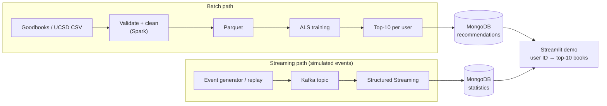

# BookPulse – Tài liệu thuyết trình

Thư mục này chứa tài liệu các buổi thuyết trình nhóm của BDA501. **Kiến trúc hệ thống hiện tại** (đã xây dựng và kiểm chứng) nằm ở [`bookpulse/docs/kien-truc.html`](../bookpulse/docs/kien-truc.html); thiết kế streaming ở [`bookpulse/docs/streaming.md`](../bookpulse/docs/streaming.md), lý do chọn mô hình ở [`bookpulse/docs/chon-mo-hinh.md`](../bookpulse/docs/chon-mo-hinh.md).

| Buổi | Nội dung | File |
|---|---|---|
| Session 5 | Đề xuất đồ án (chưa có code) | `BookPulse - BDA501 Session 5 Team Presentation.pptx`, script, hỏi đáp |
| Session 8 | Báo cáo tiến độ, số đo thật ngày 04/11/2026 | `BookPulse - BDA501 Session 8 Team Presentation.pptx`, script, hỏi đáp, câu hỏi của giảng viên |

Tài liệu mỗi buổi giữ đúng số liệu tại thời điểm trình bày. Một số số liệu Session 8 đã được cập nhật sau đó (ví dụ app chuyển sang ALS implicit, Precision@10 = 0,209); số mới nhất nằm trong `bookpulse/reports/` và báo cáo cuối kỳ.

---

## Lưu lại: kiến trúc đề xuất ở Session 5 (trước khi xây dựng)

Hệ thống có hai luồng chạy độc lập, cùng ghi vào MongoDB:

- **Batch path** (hàng trên): tạo gợi ý top-10 sách cho mỗi người dùng, chạy theo đợt (ví dụ mỗi đêm).
- **Streaming path** (hàng dưới): cập nhật số liệu rating theo thời gian thực, dùng sự kiện mô phỏng.

### Sơ đồ



Bản dạng chữ (xem được ở mọi trình đọc):

```text
BATCH PATH (chạy theo đợt)
┌──────────────┐   ┌──────────────┐   ┌─────────┐   ┌──────────┐   ┌──────────────┐   ┌───────────────┐
│ Goodbooks /  │──▶│ Validate +   │──▶│ Parquet │──▶│   ALS    │──▶│ Top-10 per   │──▶│   MongoDB     │
│ UCSD CSV     │   │ clean (Spark)│   │         │   │ training │   │ user         │   │ (gợi ý)       │
└──────────────┘   └──────────────┘   └─────────┘   └──────────┘   └──────────────┘   └───────┬───────┘
                                                                                              │
                                                                                              ▼
                                                                                     ┌─────────────────┐
                                                                                     │ Streamlit demo  │
                                                                                     │ user ID → top-10│
                                                                                     └─────────────────┘
                                                                                              ▲
STREAMING PATH (sự kiện mô phỏng)                                                             │
┌──────────────────┐   ┌─────────────┐   ┌──────────────────────┐   ┌───────────────────┐     │
│ Event generator /│──▶│ Kafka topic │──▶│ Structured Streaming │──▶│ MongoDB           │─────┘
│ replay           │   │             │   │ (Spark)              │   │ (statistics)      │
└──────────────────┘   └─────────────┘   └──────────────────────┘   └───────────────────┘
```

### Vai trò từng khối

#### Batch path

| Khối | Làm gì |
|---|---|
| Goodbooks / UCSD CSV | Dữ liệu gốc: `user_id`, `book_id`, `rating` (ai chấm cuốn nào mấy sao) |
| Validate + clean (Spark) | Bỏ dòng trùng, dòng thiếu dữ liệu, rating không hợp lệ (UCSD: rating = 0 là chưa chấm) |
| Parquet | Lưu dữ liệu sạch dạng nén theo cột, đọc lại nhanh hơn CSV |
| ALS training | Spark MLlib học gu của người dùng từ ma trận rating (collaborative filtering) |
| Top-10 per user | Tính sẵn 10 cuốn có điểm dự đoán cao nhất cho mỗi người |
| MongoDB | Lưu danh sách gợi ý, mỗi người dùng một document |

#### Streaming path

| Khối | Làm gì |
|---|---|
| Event generator / replay | Tạo sự kiện rating mô phỏng (dataset không có timestamp); cố ý chèn sự kiện trùng và lỗi để kiểm tra |
| Kafka topic | Hàng đợi sự kiện `rating-events`, tách bên gửi và bên xử lý |
| Structured Streaming | Spark đọc từ Kafka, gom theo cửa sổ thời gian, có watermark, loại trùng theo `event_id`, có checkpoint |
| MongoDB statistics | Lưu số liệu theo sách / thể loại (điểm trung bình, số lượt chấm gần đây), ghi bằng upsert |

#### Serving

| Khối | Làm gì |
|---|---|
| Streamlit demo | Nhập user ID → hiển thị top-10 sách và số liệu cập nhật trực tiếp |

### Nguyên tắc thiết kế

- **Streaming chỉ cập nhật số liệu**, không huấn luyện lại ALS sau mỗi sự kiện. Huấn luyện lại là một job batch riêng.
- Hai luồng độc lập: một luồng lỗi thì luồng kia vẫn chạy.
- App chỉ đọc kết quả tính sẵn trong MongoDB, nên trả kết quả nhanh.
- Phương án dự phòng: nếu tích hợp Kafka quá phức tạp, dùng Spark file-source streaming.
