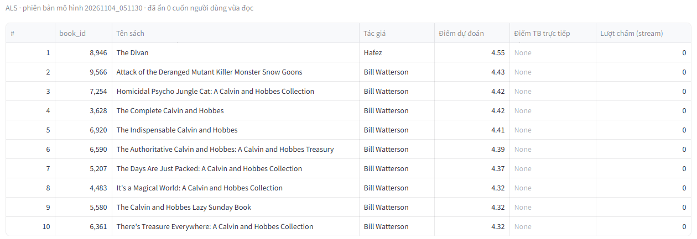
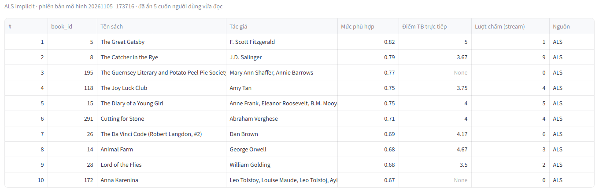

# Chọn mô hình gợi ý: vì sao BookPulse dùng ALS implicit

## Kết luận

App BookPulse dùng **ALS implicit** (`models/als_implicit`, rank 50, regParam 0,1, alpha 1,0) thay cho **ALS explicit** dùng trước đây.

Trên cùng tập test, cùng 4.987 người dùng được đánh giá, **Precision@10 tăng từ 0,008 lên 0,209**: gấp khoảng 25 lần mô hình cũ và gấp 2,6 lần cách đơn giản nhất là gợi ý sách phổ biến cho mọi người. Mô hình được chọn theo Precision@10 chứ không theo RMSE, vì người dùng chỉ thấy danh sách 10 cuốn, không thấy số sao dự đoán.

Số liệu: `reports/train_als_20261105_173703.json` (explicit) và `reports/train_als_implicit_20261105_173110.json` (implicit).

## 1. Vấn đề của mô hình cũ

ALS explicit học cách **đoán số sao** người dùng sẽ chấm, rồi gợi ý những cuốn có số sao dự đoán cao nhất. Về đoán số sao, nó làm tốt: RMSE 0,827, tốt hơn baseline tốt nhất (0,954).

Nhưng mô hình chấm điểm rất cao cho những cuốn **ít người chấm mà ai chấm cũng cho 5 sao**, như các tuyển tập truyện tranh Calvin and Hobbes hay tập thơ The Divan. Hệ quả:

- **Gợi ý gần như giống nhau cho mọi người.** Top-10 của user 1 và user 2 trùng phần lớn: Calvin and Hobbes, The Divan, The Hate U Give, The Revenge of the Baby-Sat, Humans of New York…
- **Gần như không trúng sở thích thật.** Precision@10 chỉ 0,008: trung bình 10 gợi ý trúng 0,08 cuốn. Mô hình còn thua cả cách gợi ý sách phổ biến cho tất cả mọi người (0,080).



Nói gọn: **RMSE tốt không có nghĩa là gợi ý tốt.** RMSE đo độ chính xác khi đoán số sao trên những cặp người–sách đã có rating, còn gợi ý là bài toán chọn đúng 10 cuốn trong 10.000 cuốn.

## 2. ALS explicit và ALS implicit khác nhau thế nào

Cùng thuật toán ALS (phân rã ma trận người dùng × sách) trong Spark MLlib, chỉ khác mục tiêu học:

| | ALS explicit (cũ) | ALS implicit (mới) |
|---|---|---|
| Câu hỏi mô hình học | "Người này sẽ chấm cuốn này mấy sao?" | "Người này có chọn đọc cuốn này không?" |
| Dữ liệu dùng để học | Chỉ những ô đã có rating | Mọi ô: có rating là đã chọn, trống là chưa chọn |
| Vai trò của số sao | Là đáp án cần đoán | Là độ tin cậy: `c = 1 + alpha × rating` |
| Điểm đầu ra | Số sao dự đoán (khoảng 1–5) | Mức phù hợp (thường 0–1), không phải số sao |
| Tối ưu cho | Sai số số sao (RMSE) | Thứ hạng, tức chọn đúng top-10 |

Vì implicit học cả từ những cuốn người dùng **không** chọn, nó biết sách nào hợp với gu của từng người. Đó đúng là việc của hệ thống gợi ý.

Trong Spark: `ALS(implicitPrefs=True, alpha=..., rank=..., regParam=...)`.

## 3. So sánh công bằng: cách làm

- **Cùng dữ liệu, cùng cách chia**: 5.976.484 rating, chia ngẫu nhiên với seed 42 thành 4.780.721 dòng train và 1.195.763 dòng test. Cả hai mô hình dùng đúng cùng tập train và tập test.
- **Cùng cách đánh giá**: 4.987 người dùng lấy ngẫu nhiên từ tập test. Một cuốn được tính là "liên quan" nếu người dùng chấm 4–5 sao trong tập test. Sách người dùng đã chấm trong tập train không bao giờ được gợi ý.
- **Chọn tham số không nhìn tập test**: mỗi mô hình chọn tham số trên một phần validation tách từ tập train.
  - Explicit chọn theo RMSE (TrainValidationSplit).
  - Implicit chọn theo Precision@10 (tách 80/20 từ tập train).
  - Tập test chỉ dùng **một lần** ở cuối, để tránh rò rỉ dữ liệu (leakage).
- **Kiểm tra thêm độ phủ** (số đầu sách khác nhau xuất hiện trong các top-10), để chắc rằng mô hình không chỉ lặp lại vài cuốn nổi tiếng.

## 4. Kết quả

### Trên tập test

| Mô hình | RMSE | Precision@10 | Recall@10 | Số đầu sách được gợi ý | Thời gian fit |
|---|---|---|---|---|---|
| Sách phổ biến (baseline) | – | 0,080 | 0,052 | 36 | – |
| ALS explicit (cũ) | **0,827** | 0,008 | 0,007 | 1.360 | 3,8 phút (gồm chọn 4 bộ tham số) |
| **ALS implicit (mới)** | không áp dụng | **0,209** | **0,138** | 1.214 | khoảng 2,6 phút cho lần fit cuối |

Cách đọc:
- **Precision@10 = 0,209**: trung bình 10 gợi ý có khoảng 2 cuốn đúng là sách người dùng thích (chấm 4–5 sao). Mỗi người chỉ có khoảng 15 cuốn "liên quan" trong 10.000 cuốn, nên gợi ý ngẫu nhiên chỉ được khoảng 0,0015.
- **Recall@10 = 0,138**: tìm ra được khoảng 14% số sách người dùng thích chỉ trong 10 gợi ý.
- **1.214 đầu sách**: gần bằng mô hình explicit (1.360) và gấp khoảng 34 lần baseline (36). Mô hình implicit vẫn cá nhân hóa, không chỉ gợi ý sách phổ biến.

### Chọn tham số trên validation (implicit)

| rank | alpha | Precision@10 (validation) | Recall@10 (validation) |
|---|---|---|---|
| 20 | 1 | 0,118 | 0,099 |
| 20 | 10 | 0,094 | 0,078 |
| **50** | **1** | **0,139** | **0,115** |
| 50 | 10 | 0,101 | 0,084 |

regParam cố định 0,1. Rank lớn hơn (50 yếu tố ẩn) mô tả gu đọc chi tiết hơn. Alpha 10 kém hơn alpha 1, vì số sao chỉ từ 1 đến 5: nhân lên quá mạnh làm mô hình quá tin vào từng lượt chấm.

Precision@10 trên validation thấp hơn trên test (0,139 so với 0,209) vì lúc chọn tham số, mô hình chỉ được học trên 80% tập train và mỗi người có ít sách "liên quan" hơn trong phần validation. Khi chọn tham số, điều quan trọng là **thứ hạng giữa các bộ tham số**, không phải giá trị tuyệt đối.

## 5. Ví dụ trước và sau

| | ALS explicit (cũ) | ALS implicit (mới) |
|---|---|---|
| User 1 | Calvin and Hobbes (7 cuốn khác nhau), The Hate U Give, The Revenge of the Baby-Sat, Humans of New York | The Great Gatsby, The Catcher in the Rye, The Guernsey Literary and Potato Peel Pie Society, The Joy Luck Club, The Diary of a Young Girl… |
| User 2 | The Divan, Calvin and Hobbes (5 cuốn), The Hate U Give, The Revenge of the Baby-Sat, Humans of New York, Just Mercy… | The Alchemist, Animal Farm, The 7 Habits of Highly Effective People, Huckleberry Finn, 1984, Freakonomics… |
| User 3 | Holy Bible, Preach My Gospel, The Divan, Book of Mormon… | Romeo and Juliet, Animal Farm, The Great Gatsby, Hamlet, Jane Eyre, Pride and Prejudice… |

Với mô hình mới, mỗi người nhận một danh sách riêng theo gu đọc: user 1 thiên về văn học, user 2 có thêm sách phi hư cấu và phát triển bản thân, user 3 thiên về văn học cổ điển.



## 6. Vì sao chọn ALS implicit

1. **Đúng mục tiêu của sản phẩm.** Người dùng chỉ thấy 10 cuốn, nên thước đo phải là chất lượng top-10 (Precision@10, Recall@10), không phải sai số số sao.
2. **Tốt hơn rõ rệt trên đúng thước đo đó.** Precision@10 0,209 so với 0,008 (explicit) và 0,080 (sách phổ biến), trên cùng tập test và cùng người dùng.
3. **Vẫn cá nhân hóa.** 1.214 đầu sách được gợi ý so với 36 của baseline; danh sách khác nhau theo từng người.
4. **Không đổi kiến trúc.** Vẫn là ALS trong Spark MLlib, cùng cách ghi vào MongoDB và cùng app. Chỉ đổi tham số mô hình và nhãn một cột hiển thị.
5. **Chọn tham số đúng quy trình.** Chọn trên validation, test chỉ dùng một lần, nên con số 0,209 không bị thổi phồng do leakage.

## 7. Đánh đổi và giới hạn

- **Không còn đoán số sao.** Điểm của mô hình implicit là mức phù hợp (khoảng 0–1), nên app đổi tên cột "Điểm dự đoán (sao)" thành "Mức phù hợp", và RMSE không áp dụng cho mô hình này. Mô hình explicit vẫn được giữ trong `models/als` để báo cáo RMSE.
- **Nghiêng về sách nổi tiếng hơn.** Ví dụ Animal Farm và The Great Gatsby xuất hiện ở danh sách của nhiều người, và độ phủ thấp hơn explicit một chút (1.214 so với 1.360). Đây là đặc điểm thường gặp của mô hình implicit; có thể giảm bằng cách thêm hình phạt độ phổ biến khi xếp hạng (chưa làm).
- **Mới thử 4 bộ tham số** (rank 20 hoặc 50, alpha 1 hoặc 10). Có thể còn bộ tốt hơn, ví dụ rank lớn hơn hoặc regParam khác.
- **Chia train/test ngẫu nhiên**, vì Goodbooks-10k không có thời điểm chấm. Chia theo thời gian sẽ sát thực tế hơn, nhưng không làm được với dữ liệu này.
- **Đánh giá online trong app vẫn chưa có ý nghĩa**, vì streaming đang phát lại rating đã có trong tập train (xem slide rủi ro Session 8). Kết luận ở tài liệu này dựa trên đánh giá offline trên tập test.

## 8. Chạy lại

```bash
docker compose exec spark python batch/train_als.py                     # explicit + baseline (RMSE, Precision@10)
docker compose exec spark python batch/train_als.py --implicit --ranks 20,50 --regs 0.1 --alphas 1,10
docker compose exec spark python batch/write_recs.py --books data/goodbooks/books.csv          # mặc định: als_implicit
docker compose restart app                                              # để Streamlit nạp lại code nếu vừa sửa app.py
```

Quay về mô hình cũ: `docker compose exec spark python batch/write_recs.py --books data/goodbooks/books.csv --model als`.

## 9. Trả lời ngắn khi bị hỏi

> Ban đầu nhóm dùng ALS explicit, mô hình đoán số sao. RMSE tốt hơn baseline, nhưng khi đo đúng thứ người dùng thấy là top-10, Precision@10 chỉ 0,008, thua cả việc gợi ý sách phổ biến. Lý do là mô hình đẩy lên những cuốn ít người chấm nhưng toàn 5 sao, nên ai cũng nhận gần như cùng một danh sách Calvin and Hobbes. Nhóm chuyển sang ALS implicit, học xem người dùng có chọn đọc cuốn nào, và chọn tham số theo Precision@10 trên tập validation. Trên tập test, Precision@10 lên 0,209, gấp 2,6 lần baseline, mà vẫn gợi ý hơn 1.200 đầu sách khác nhau. Đổi lại, mô hình không còn đoán số sao và hơi nghiêng về sách nổi tiếng.
